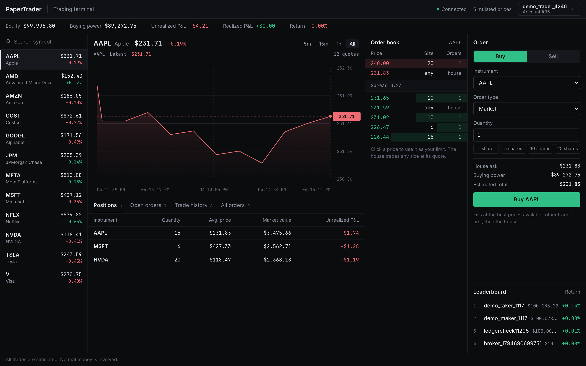
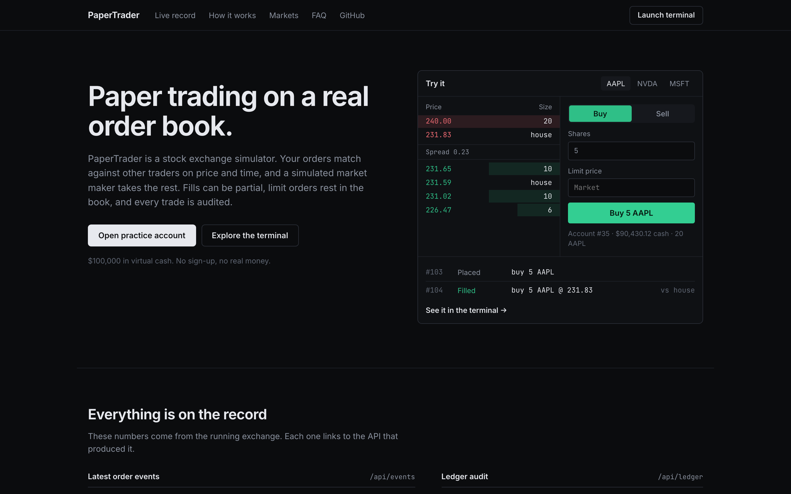
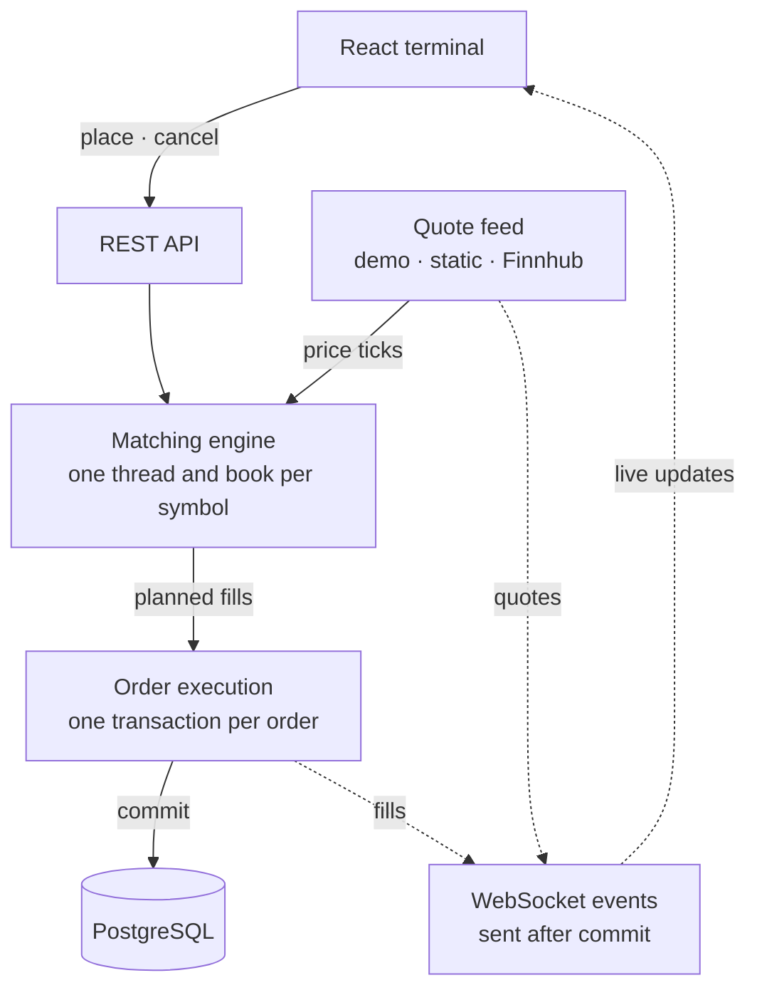
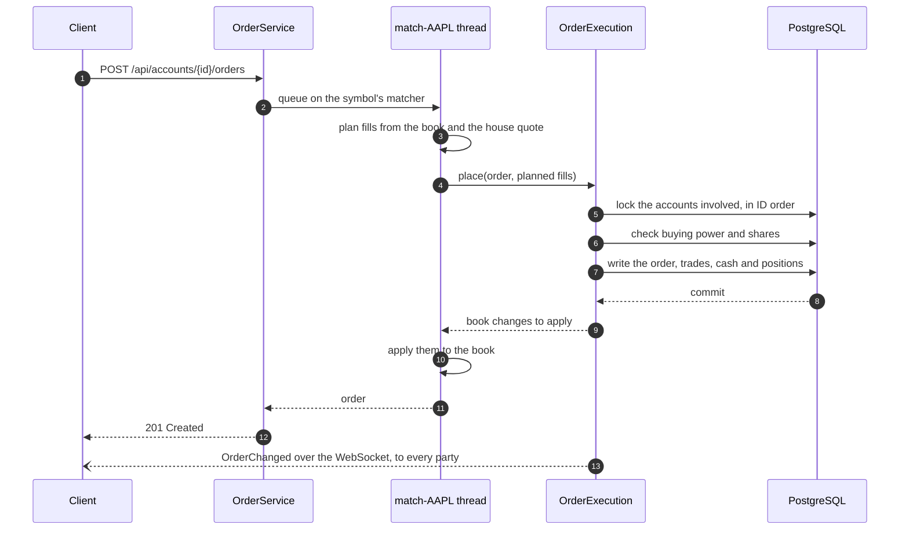
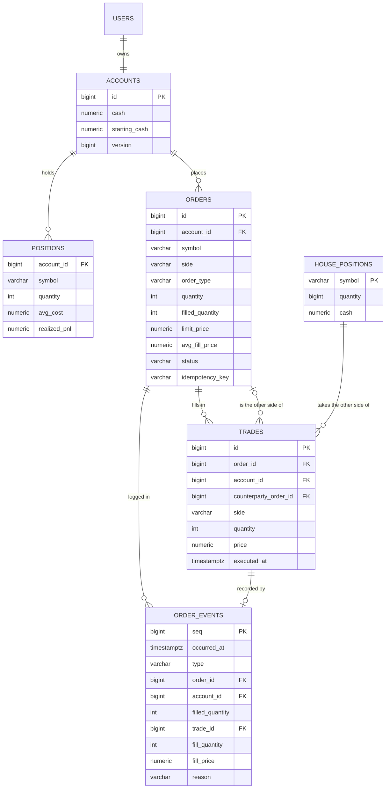

<div align="center">

# PaperTrader

**A paper-trading simulator with a real matching engine.**<br>
Trade against other users and a simulated market maker, watch partial fills land live, and track your P&L. No real money involved.

[](https://github.com/nishantshah0/paper-trader/actions/workflows/ci.yml)
[](LICENSE)


[Quick start](#quick-start) · [How matching works](#how-matching-works) · [Architecture](#architecture) · [API](#api) · [Design notes](docs/architecture.md)



<sub>The trading terminal. The order book shows other traders' resting orders around the house's bid and ask; click a price to use it as your limit. Fills, cash and positions update over the WebSocket.</sub>

</div>

## Highlights

- **Order book with price-time priority.** Users trade with each other first, best price then oldest. Orders fill in parts, and a partly filled order keeps its place in the queue.
- **A simulated market maker.** The house quotes a bid and an ask around the feed price, so a market order always has something to trade with, even if you're the only user.
- **One matcher thread per symbol.** Symbols match in parallel and nothing within a symbol interleaves. Postgres stays the source of truth.
- **Books that always balance.** The house keeps its own books, so every dollar and share a user gains, the house gives up. A ledger audit proves nothing was created or destroyed, and it runs after every integration test.
- **A complete audit trail.** Every order event (placed, partly filled, filled, cancelled, rejected) is logged with a sequence number in the same transaction as the change, so the log never disagrees with the books.
- **Safe under concurrency.** Accounts are locked in ID order so trades can't deadlock, the book changes only after the transaction commits, and retries with an `Idempotency-Key` never place the same order twice.
- **A full trading terminal.** Everything on one screen: a searchable watchlist, a chart with a crosshair and time ranges, an order book ladder you can click to set a limit price, the order ticket, positions and order history, and a leaderboard.
- **A home page that proves it.** A live demo places a real order and shows the events it created, next to the running event log and ledger audit.
- **Live everywhere.** Fills, quotes and portfolio changes are pushed over STOMP WebSockets to every open tab, with a polling fallback.
- **Tested against the real thing.** The backend tests run on Postgres through Testcontainers, and Playwright and Cypress drive the packaged app in CI.

> [!NOTE]
> No real money or brokerage connection. The default feed generates simulated prices; an optional Finnhub mode uses real quotes. Practice accounts are unauthenticated, so this is built for local use.

## Quick start

With Docker running:

```bash
git clone https://github.com/nishantshah0/paper-trader.git
cd paper-trader
docker compose --profile app up --build -d --wait
```

Open **http://localhost:8080**, choose **Open practice account**, pick a lowercase name and you start with **$100,000** in virtual cash. Keep the account ID to reopen the account later. The terminal is at **http://localhost:8080/terminal**.

The first build downloads Java and Node dependencies. The app and database listen on localhost only. To stop them and keep your data:

```bash
docker compose --profile app down
```

<details>
<summary><b>Screenshots</b></summary>
<br>

The home page, with a working demo that places a real order and shows the events it created:



</details>

## How matching works

Each symbol has two sources of liquidity:

| Source           | Prices                                                                                                    | Size                  |
| ---------------- | --------------------------------------------------------------------------------------------------------- | --------------------- |
| **Other users**  | Their resting limit orders                                                                                | What they posted      |
| **The house**    | A bid and an ask either side of the feed price, 10 basis points apart by default (`HOUSE_SPREAD_BPS`)     | Any, priced by size   |

An incoming order:

1. Trades with resting user orders, best price first and oldest first within a price, at each resting order's limit.
2. Stops at its own limit, or at any level where the house offers a better price. At an equal price the user goes first.
3. Trades whatever is left with the house, which charges more per share for more shares. A limit order takes only the shares whose price stays within its limit.
4. If shares are still left, a limit order **rests in the book, partly filled**. A market order always fills completely.

Users meet inside the spread; an order priced through the house trades with the house. When the house's quote moves, resting orders it crosses fill in full at its price. An order that would trade with the same account's resting order is refused.

### Prices move with trading

The house is a market maker, not a bottomless wall of liquidity:

- **Trading moves the price.** The house's price depends on one number: how many shares users have bought from it, net, recently. It leans by `HOUSE_IMPACT_BPS` × √(net shares / `HOUSE_DEPTH_SHARES`), the square-root law real market impact follows. By default, net buying of 500 shares lifts the price 10 basis points, and 2,000 shares lift it 20. That volume fades towards zero by `HOUSE_IMPACT_DECAY` on every quote tick, so the price drifts back to the feed.
- **Size costs more, and splitting doesn't help.** Each fill pays the house's price averaged along that curve, from where the volume was to where the fill leaves it. So buying 1,000 shares costs the same in one order as in a thousand, and selling them back walks the same curve the other way. A round trip can only lose the spread, however it's split. Unit tests attack this with uneven splits, one-share pieces, selling first and 1,000 random sequences, and none makes money. The one thing that can pay is selling into a price *other* traders pushed up and buying back after it fades: that's trading against their flow, not a hole in the house's prices.
- **The book leans the quote.** The house shifts its quote towards whichever side has more resting shares within 0.25% of the price, as real market makers read order book imbalance. The lean is scaled by the house's depth, so it takes real size to move it: a 1-share bid leans the price by a few hundredths of a basis point, and only a very large imbalance approaches the `HOUSE_IMBALANCE_BPS` maximum. That makes spoofing possible but not free: a large bid that is never meant to fill lifts the price a seller gets, and it risks being filled. An integration test shows a 900-share fake bid letting the spoofer sell 3.6 basis points higher than an honest seller.

<details>
<summary><b>Worked example</b></summary>
<br>

The feed is at 50.00 with a 1% spread, so the house bids **49.75** and asks **50.25**.

| Step | Order                                 | Fills                                                     | Result                                        |
| ---- | ------------------------------------- | --------------------------------------------------------- | --------------------------------------------- |
| 1    | Alice (holds 10): sell limit 10 @ 50.10 | None yet                                                | Rests in the book, beating the house ask      |
| 2    | Bob: market buy 4                     | 4 @ 50.10 from Alice                                      | Alice's sell is 4/10 filled                   |
| 3    | Bob: market buy 8                     | 6 @ 50.10 from Alice, then 2 @ 50.25 from the house       | Alice is filled; Bob's average is 50.1375     |

This is the `usersInsideTheSpreadTradeWithEachOtherAndTheRestGoesToTheHouse` integration test.

</details>

### Book mode: no house

Set `MARKET_MODE=book` and the house is gone: orders only trade with each other, so trading alone sets the price. This is the mode for bot markets, where a pump has to be able to move the price and a manipulator's profit has to come from other traders.

- A market order takes what the book holds and the rest is cancelled. With nothing on the other side, it's refused.
- The feed keeps running as a reference value that traders can watch, but nothing is priced from it.
- Positions are valued at the last trade, not the feed. Buying through thin asks moves the price as far as the book lets it, and it stays there until someone trades it back.
- A book market has no other source of shares, so a simulated run starts by allocating them (see [Simulated time](#simulated-time)).

### Bot markets

One command runs a whole market of simulated traders, in book mode on the simulated clock:

```bash
./mvnw spring-boot:run -Dspring-boot.run.profiles=bots   # wipes the local database first
```

It resets the exchange, runs 100 noise traders and 8 market makers across all twelve stocks for an hour of market time, logs a report, and leaves the app up so you can browse the result. `BOT_SEED`, `BOT_TICKS`, `BOT_NOISE_TRADERS` and `BOT_MARKET_MAKERS` change the run, and `POST /api/bots/runs` starts one from a running app.

- **Noise traders** buy and sell at random, in random sizes. Some orders take what the book offers and some are limit orders a little off the middle, and they give up on old ones. They only see the book and the last trade.
- **Market makers** each quote a few stocks around the feed price, which only they see. They pull and re-post their quotes, shifted against their inventory. They're what keeps trading anchored to the feed.

In a measured run (seed 1, defaults), 108 bots took 45,423 actions in 64 seconds: 10,324 trades between bots, 15 refused orders and a balanced ledger. Every stock's last trade ended within 31 bps of its feed price. The bots call the order service directly rather than going over HTTP, so their orders are checked, matched, logged and audited like anyone's.

What makes a run usable for grading a detector:

- **It replays exactly.** The same request writes the same rows, down to the ids and the millisecond timestamps. A test runs a market twice and compares a hash of every event, trade and balance.
- **Bots don't share random numbers.** Each bot has its own random streams, seeded from the run's seed and the bot's name: one for when it wakes and one for what it does. Rerunning a market without one bot leaves every other bot's schedule exactly as it was, so the difference is that bot's effect.
- **Bots act through each tick.** Each bot wakes at random intervals (exponential gaps), and the clock moves to each wake, so the event log has realistic timing between orders and cancels.
- **Only the answer key says who is who.** Accounts are named `trader_0001` and up, opened in an order shuffled by the seed, so neither the name nor the id gives a bot away. The `answer_key` table records each account's bot and kind for grading; a detector reads only the market data.

**Reservations.** Open limit orders reserve what they still need: a buy holds its limit price times its remaining shares, and a sell holds its remaining shares. New orders can only use buying power and shares that aren't already reserved, so a resting order stays funded until it fills or is cancelled. Cancelling a partly filled order keeps what already filled.

**Simplifications.** Fills are whole-share and long-only, with no commissions, shorting, or slippage beyond the house spread.

## Architecture

### System overview



- **One matcher per symbol.** A single thread owns each symbol's book and runs every placement, cancel and quote-driven fill for it in turn. Symbols match in parallel, and nothing within a symbol interleaves.
- **Postgres is the record.** The in-memory book is only an index of open orders. It's rebuilt from the `orders` table on startup, and reloaded if the book and the database ever disagree.
- **Events after commit.** Account updates go out over the WebSocket only once the transaction commits, so a client never sees a fill that was rolled back.

### Life of an order



The request thread holds no database connection while it waits for the matcher, so a busy symbol can't drain the connection pool. If the order hasn't started after 10 seconds, it's cancelled before it ever runs and the client gets a 503, which therefore always means nothing happened and the request is safe to retry. An order already running when the wait runs out is inside its transaction, so the client waits for its real result instead. If anything fails before the commit, the book is untouched and the client gets a problem response. Reading the book or the house's prices never waits at all: each matcher publishes a snapshot after every change.

### Concurrency and correctness

| Problem                                            | How it's handled                                                                                                   |
| -------------------------------------------------- | ------------------------------------------------------------------------------------------------------------------ |
| Two orders on one symbol racing for the same shares | They're queued on that symbol's matcher thread, so they run one after the other.                                    |
| Two users trading on two symbols at once           | Both transactions lock the same pair of accounts, always lowest ID first, so neither can hold what the other needs. |
| A transaction that rolls back                      | Fills are only planned in memory. The book changes after the commit, so a failure leaves nothing to undo.           |
| The book drifting from the database                | Each fill checks the order's row. On a mismatch the symbol's book is reloaded and the order retried once.           |
| Spending the same cash twice                       | Open orders reserve the cash or shares they still need, and every order is checked against what's left.            |
| A client retrying a request                        | The same `Idempotency-Key` and payload returns the original order. A different payload gets a 409.                 |
| A stale price feed                                 | The house stops trading until a fresh quote arrives. Market orders are refused; limit orders wait.                  |
| Money or shares appearing from nowhere             | The house keeps its own books, and the ledger audit checks that everything balances after every integration test.   |

### Data model



The schema is managed by Flyway, and Hibernate only validates it. Check constraints in the database back up the rules in the code: cash and positions can't go negative, an order can't fill more than its quantity, and only a fully filled order can be `FILLED`. A trade with no `counterparty_order_id` was against the house, and moved the house's row for that symbol the opposite way. The house can be short and out of pocket, so its quantity and cash may go negative. `order_events` is append-only: one row each time an order is placed, fills, or ends, plus orders refused before they were placed, which have no `order_id`.

### Repository layout

```text
src/main/java/.../papertrader/
├── account/      accounts and users
├── bots/         the bot runner, noise traders, market makers and the answer key
├── ledger/       the ledger audit
├── portfolio/    portfolio valuation, P&L and the leaderboard
├── quote/        price feed, quote cache and history
├── trading/      order book, matching engine, order execution, positions
└── web/          WebSocket config, events and error handling
src/main/resources/db/migration/   Flyway migrations, V1 to V7
frontend/src/                      React home page and trading terminal
frontend/tests/                    Playwright browser and WebSocket tests
frontend/cypress/                  Cypress buying-power tests
docs/architecture.md               design notes and tradeoffs
docs/performance.md                load test results and bottleneck analysis
tools/loadtest/                    the load generator
```

More on the threading model, the race handling and the tradeoffs is in [docs/architecture.md](docs/architecture.md).

### Tech stack

| Layer    | Tools                                                                       |
| -------- | --------------------------------------------------------------------------- |
| Backend  | Java 21, Spring Boot 4.1, Spring Data JPA, Flyway, STOMP WebSockets          |
| Database | PostgreSQL 17                                                               |
| Frontend | React 19, Vite 7, STOMP.js                                                  |
| Testing  | JUnit, Testcontainers, Mockito, Playwright, Cypress                        |
| Delivery | Docker Compose, GitHub Actions                                              |

## Quote modes

| Mode             | Behavior                                                       |
| ---------------- | -------------------------------------------------------------- |
| `demo` (default) | A simulated random walk, updated every 15 seconds and labeled. Set `FEED_SEED` to replay the same prices; otherwise the seed is logged at startup. |
| `static`         | Configured prices never change, for deterministic experiments. |
| `finnhub`        | Real provider quotes, fetched server-side. Needs your own key. |

### Simulated time

Set `CLOCK_MODE=simulated` and time stands still at `CLOCK_START` until you advance it:

```bash
curl -X POST 'http://localhost:8080/api/simulation/ticks?count=40'   # ten minutes of market time, instantly
curl http://localhost:8080/api/simulation                            # clock, time, ticks taken, feed seed
```

Each tick moves the clock to the next point on a fixed grid of feed intervals, draws every stock's next price from the seeded walk, then lets each stock's matcher react in turn. Between ticks, the clock can also move by less than a tick, so an order and its cancel a fraction of a second later get their own timestamps. A bot runner also needs to hand out starting shares, which are bought from the house at the feed price:

```bash
curl -X POST 'http://localhost:8080/api/simulation/advance?millis=250'                       # within the current tick
curl -X POST 'http://localhost:8080/api/simulation/allocations?accountId=1&symbol=AAPL&shares=500'
```

 Every timestamp the app writes comes from that clock. So a run that starts from the same `FEED_SEED` and places the same orders in the same order produces the same event log, prices, balances and timestamps, down to the database ids. An integration test runs a scripted session twice and compares all of it. On the normal wall clock, the tick endpoint answers 409.

<details>
<summary><b>Using Finnhub</b></summary>
<br>

Copy `.env.example` to `.env` and set:

```dotenv
FEED_MODE=finnhub
FINNHUB_API_KEY=your_key
FEED_INTERVAL_MS=15000
```

Then rerun the Quick start Compose command. The key stays on the server. The adapter calls [Finnhub's quote endpoint](https://finnhub.io/docs/api/quote); twelve symbols at the default interval use up to 48 requests a minute, so set the interval to fit your plan.

Live mode never executes against seed prices, and a quote must be under 120 seconds old to trade on. When the feed is stale, including outside market hours, the house stops trading: market orders are refused and limit orders rest until a fresh quote crosses them. Users can still trade with each other. The tests never contact Finnhub.

</details>

## Development

You'll need **JDK 21**, **Node 22** and Docker. Maven comes with the wrapper, and `.nvmrc` pins the Node version.

```bash
# Backend (Spring Boot starts the Compose database for you)
./mvnw spring-boot:run

# Frontend, in another terminal
cd frontend
npm ci
npm run dev
```

On Windows, use `.\mvnw.cmd`. Vite proxies REST and WebSocket traffic to port 8080. Stop the packaged app container before running the backend locally.

### Running the tests

```bash
./mvnw verify                          # backend, against real Postgres
cd frontend
npm ci
npm run format:check
npm run build
npx playwright install chromium
npm test                               # browser tests, against the running app
```

Browser tests expect the full app at `http://127.0.0.1:8080`; set `E2E_BASE_URL` to point them elsewhere. They create throwaway accounts, so use a disposable database if you care about a clean practice environment.

After every integration test, the ledger audit checks that the books still balance and that the event log agrees with them, so any test that moves money also tests that none went missing. The tests cover the order event log, user-to-user and partial fills, price-time and house priority, self-trade refusal, concurrent trades between the same accounts on two symbols, scheduled limit fills, double-spend and fill/cancel races, idempotent retries, stale quotes, migrations, P&L, navigation, account persistence, responsive layouts, and WebSocket delivery across two tabs. CI runs on every pull request and on main.

## Performance

On an Apple M3 laptop, with the app and Postgres in Docker, the exchange handles about **2,000 orders a second** (2,500 requests a second with cancels). It reaches that with 10 simulated traders; past that, more traders only add waiting, taking p99 latency from 12 ms at 10 traders to 540 ms at 500. Every level finished with no errors and balanced books, across 134,000 trades.

The limit is database round trips inside each order's transaction. It isn't CPU, disk flushing, the connection pool size or the one-thread-per-stock design. Each of those was ruled out by changing it alone.

Bot runs that replay exactly have to act one at a time, so that speed is measured separately, in-process. Logging every SQL statement found a lazy-loading miss, a redundant existence check and repeated position reads. Fixing them cut statements per action from 11.4 to 7.7 and took a one-at-a-time bot market from 547 to 677 actions a second. `BotSpeedTest` fails if the count creeps back up. The method, numbers and thread-dump findings are in [docs/performance.md](docs/performance.md), and the load generator is a single Java file:

```bash
java tools/loadtest/LoadTest.java --levels 1,10,50,200,500 --seconds 20
```

## API

All bodies are JSON and errors are [RFC 9457](https://www.rfc-editor.org/rfc/rfc9457) problem details. Cash has two decimal places; prices and average costs use four decimal places. Everything is USD.

| Method | Path                                    | Purpose                                    |
| ------ | --------------------------------------- | ------------------------------------------ |
| POST   | `/api/accounts`                         | Create a practice account                  |
| GET    | `/api/accounts/{id}`                    | Cash and starting balance                  |
| GET    | `/api/accounts/{id}/portfolio`          | Positions, value and P&L                   |
| POST   | `/api/accounts/{id}/orders`             | Place an order (optional `Idempotency-Key`) |
| GET    | `/api/accounts/{id}/orders?status=OPEN` | List orders; `status` is optional          |
| GET    | `/api/accounts/{id}/orders/{orderId}`   | One order                                  |
| DELETE | `/api/accounts/{id}/orders/{orderId}`   | Cancel an open order                       |
| GET    | `/api/accounts/{id}/trades`             | Fills, newest first                        |
| GET    | `/api/book/{symbol}`                    | Top 10 price levels, the house quote and the last trade |
| GET    | `/api/book/{symbol}/estimate?side=&shares=` | What a market order of that size would pay per share |
| GET    | `/api/quotes`, `/api/quotes/{symbol}`   | Cached quotes and timestamps               |
| GET    | `/api/quotes/status`                    | Feed mode                                  |
| GET    | `/api/quotes/history`                   | Up to 240 recent quotes per symbol         |
| GET    | `/api/leaderboard`                      | Top 20 by return percentage                |
| GET    | `/api/events?after=&symbol=&accountId=` | Order event log, by sequence number        |
| GET    | `/api/events/recent`                    | The latest order events, newest first      |
| GET    | `/api/ledger`                           | Run the ledger audit; the house's books    |
| GET    | `/api/simulation`                       | Clock mode, time, ticks taken, feed seed   |
| POST   | `/api/simulation/ticks?count=`          | Advance a simulated clock by whole ticks   |
| POST   | `/api/simulation/advance?millis=`       | Move a simulated clock within the current tick |
| POST   | `/api/simulation/allocations?accountId=&symbol=&shares=` | Sell an account starting shares at the feed price (simulated clock only) |
| POST   | `/api/bots/runs`                        | Run a whole bot market (book mode, simulated clock); returns the report |
| GET    | `/api/bots/answer-key`                  | Which account is which bot, for grading     |
| GET    | `/actuator/health`                      | Health check                               |

<details>
<summary><b>Example: place a limit order</b></summary>
<br>

```bash
curl -X POST http://localhost:8080/api/accounts/1/orders \
  -H 'Content-Type: application/json' \
  -H 'Idempotency-Key: 6f1c2a' \
  -d '{"symbol":"AAPL","side":"BUY","type":"LIMIT","quantity":2,"limitPrice":225.50}'
```

Leave out `type` and `limitPrice` for a market order.

</details>

**WebSockets.** Connect to the STOMP endpoint at `/ws` and subscribe to `/topic/quotes` and `/topic/accounts/{id}`. Account events fire after commit and tell the client to refresh its portfolio, orders and trades. Browsers can't publish to the broker.

## Limitations

- **No authentication.** Account IDs aren't passwords. Add identity and authorization before deploying publicly.
- **Small-scale by design.** Order and trade lists aren't paginated.
- **Out of scope.** Corporate actions, exchange calendars, persistent price history and distributed messaging.

## What I'd do next

- **Cheaters and a detector.** Bots that spoof, wash-trade and pump-and-dump among the honest ones, and a surveillance system graded against the answer key.
- **More order types.** Stop orders, time-in-force (IOC, FOK, day) and amend-in-place.
- **Persist quote history.** Chart history lives in memory and resets on restart.
- **Authentication**, so it can be hosted publicly.

## Contributing

See [CONTRIBUTING.md](CONTRIBUTING.md) for setup, checks and guidelines. Please use the issue forms for bugs and feature requests.

## License

[MIT](LICENSE)
