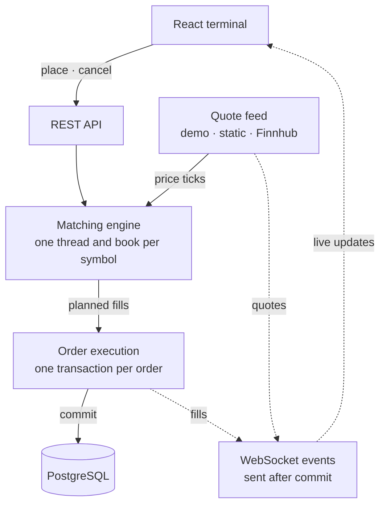
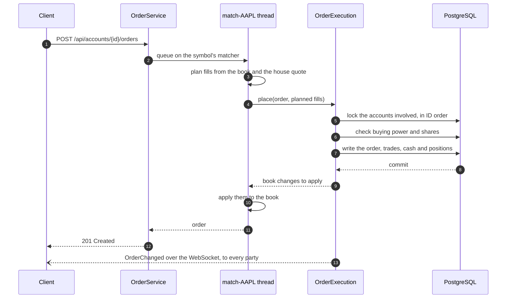
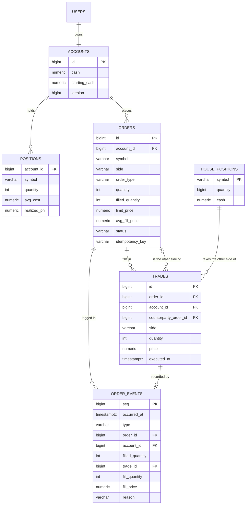

# How it's built

The system, an order's path through it, the data model and the code layout. For why it's built this way (threading, races, the ledger, time), see [architecture.md](architecture.md).


## System overview



- **One matcher per symbol.** A single thread owns each symbol's book and runs every placement, cancel and quote-driven fill for it in turn. Symbols match in parallel, and nothing within a symbol interleaves.
- **Postgres is the record.** The in-memory book is only an index of open orders. It's rebuilt from the `orders` table on startup, and reloaded if the book and the database ever disagree.
- **Events after commit.** Account updates go out over the WebSocket only once the transaction commits, so a client never sees a fill that was rolled back.

## Life of an order



The request thread holds no database connection while it waits for the matcher, so a busy symbol can't drain the connection pool. If the order hasn't started after 10 seconds, it's cancelled before it ever runs and the client gets a 503, which therefore always means nothing happened and the request is safe to retry. An order already running when the wait runs out is inside its transaction, so the client waits for its real result instead. If anything fails before the commit, the book is untouched and the client gets a problem response. Reading the book or the house's prices never waits at all: each matcher publishes a snapshot after every change.

## Concurrency and correctness

| Problem                                            | How it's handled                                                                                                   |
| -------------------------------------------------- | ------------------------------------------------------------------------------------------------------------------ |
| Two orders on one symbol racing for the same shares | They're queued on that symbol's matcher thread, so they run one after the other.                                    |
| Two users trading on two symbols at once           | Both transactions lock the same pair of accounts, always lowest ID first, so neither can hold what the other needs. |
| A transaction that rolls back                      | Fills are only planned in memory. The book changes after the commit, so a failure leaves nothing to undo.           |
| The book drifting from the database                | Each fill checks the order's row. On a mismatch the symbol's book is reloaded and the order retried once.           |
| Spending the same cash twice                       | Open orders reserve the cash or shares they still need, and every order is checked against what's left.            |
| A client retrying a request                        | The same `Idempotency-Key` and payload returns the original order. A different payload gets a 409.                 |
| A stale price feed                                 | The house stops trading until a fresh quote arrives. Market orders are refused; limit orders wait.                  |
| Money or shares appearing from nowhere             | The house keeps its own books, and the ledger audit checks that everything balances after every integration test.   |

## Data model



The schema is managed by Flyway, and Hibernate only validates it. Check constraints in the database back up the rules in the code: cash and positions can't go negative, an order can't fill more than its quantity, and only a fully filled order can be `FILLED`. A trade with no `counterparty_order_id` was against the house, and moved the house's row for that symbol the opposite way. The house can be short and out of pocket, so its quantity and cash may go negative. `order_events` is append-only: one row each time an order is placed, fills, or ends, plus orders refused before they were placed, which have no `order_id`.

## Repository layout

```text
src/main/java/.../papertrader/
├── account/      accounts and users
├── bots/         the bot runner, the honest bots, the spoofer and the answer key
├── surveillance/ the detectors, which read only the event log
├── grading/      scoring alerts against the answer key, and multi-seed evaluations
├── jobs/         long work (bot runs, evaluations) off the request thread
├── ledger/       the ledger audit
├── portfolio/    portfolio valuation, P&L and the leaderboard
├── quote/        price feed, quote cache and history
├── trading/      order book, matching engine, order execution, positions
└── web/          WebSocket config, events and error handling
src/main/resources/db/migration/   Flyway migrations, V1 to V8
frontend/src/                      React home page and trading terminal
frontend/tests/                    Playwright browser and WebSocket tests
frontend/cypress/                  Cypress buying-power tests
docs/architecture.md               design notes and tradeoffs
docs/performance.md                load test results and bottleneck analysis
docs/red-team/                     published AI red-team runs, read by the public desk
tools/loadtest/                    the load generator
tools/lab/                         runs many seeded markets at once, one per worker
tools/agent/                       an AI cheater: Claude searches for spoofing tactics the detector misses
```

More on the threading model, the race handling and the tradeoffs is in [docs/architecture.md](architecture.md).

## Tech stack

| Layer    | Tools                                                                       |
| -------- | --------------------------------------------------------------------------- |
| Backend  | Java 21, Spring Boot 4.1, Spring Data JPA, Flyway, STOMP WebSockets          |
| Database | PostgreSQL 17                                                               |
| Frontend | React 19, Vite 7, STOMP.js                                                  |
| Testing  | JUnit, Testcontainers, Mockito, Playwright, Cypress                        |
| Delivery | Docker Compose, GitHub Actions                                              |
